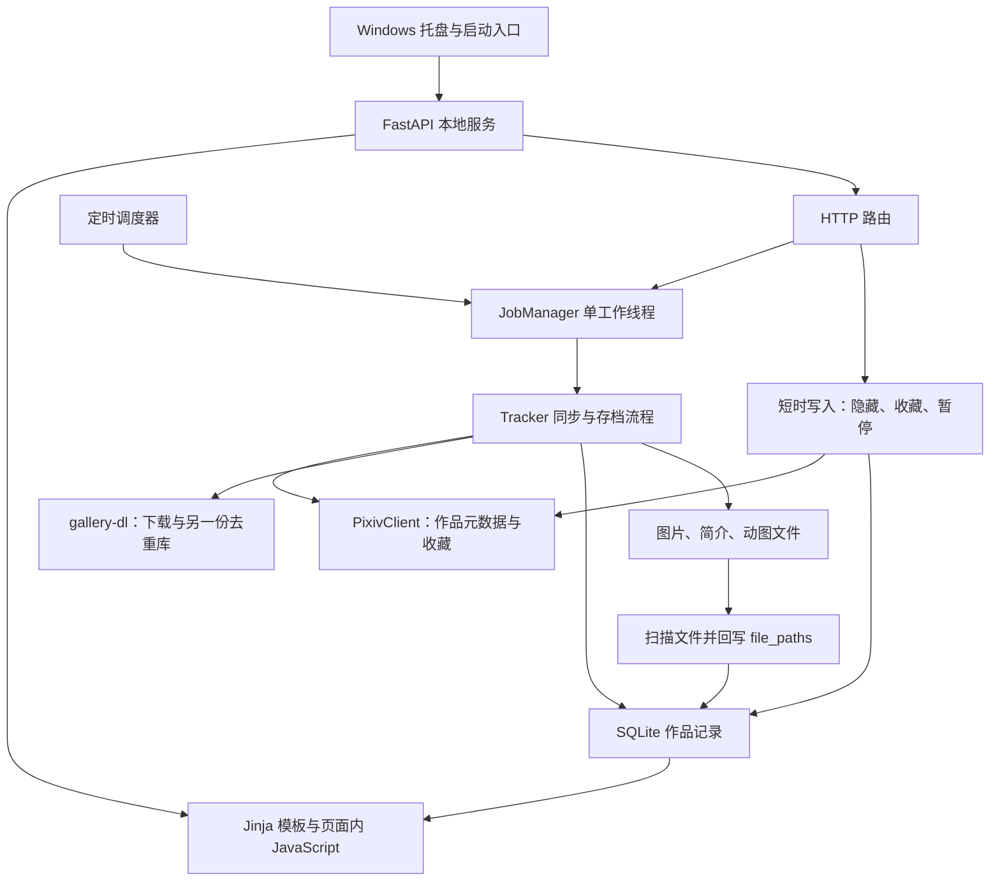

# Pixiv Tracking Tool 全面审查

审查日期：2026-09-08。主策划兼技术组长。对象：本地 `master / 3705098`，实现版本 `0.1.1`。此次只审查、验证和维护文档，没有修改应用代码、配置、令牌、正式图库或原有 release。

## 先给判断

**项目可以继续发展，不需要推倒重写；但当前还不能把“可靠自动存档”当作已经完成的基础。** 主要问题不是 Python、SQLite 或浏览器界面选错了，而是有些重要概念没有被准确建模，靠几处条件判断和重复流程维持。一旦发生缺页、接口失败、切换目录或连续筛选，这些判断就会互相矛盾。

最应该停止沿用的三种写法：

1. **把“找到至少一个文件”当作“作品下载完整”。** 三页作品只剩一页，甚至只剩一个零字节文件，也会被标为已下载。
2. **把“没有抛出异常”当作“外部操作成功”。** 下载库的失败返回值、Pixiv HTTP 错误都可能被忽略。
3. **同一个状态由多处分别维护。** 文件目录、数据库、运行配置分别切换；筛选条件、翻页状态、收藏按钮也各有一套更新逻辑，缺少统一的完成条件。

本轮按根因与处理范围收敛为 **14 组问题：重开 BUG-015、021、022，新增 BUG-036～046**。它们不是 14 次用户真实事故，而是当前源码的隔离复现或明确调用证据；真实图库是否已经受影响，本次没有查询。原有 BUG-033／034 仍然存在。

建议先讨论和修正存档可靠性，再统一浏览操作状态，随后建立面向客户端扩展的内部边界。原路线图中的 v0.1.2 仍未获批，也不宜继续只按两项进度显示问题来理解其候选范围。

## 审查范围与证据

通读当前 `app/` 的 **60 个维护文件**：40 个 Python 文件、9 个模板、样式、两份图形素材、构建与启动文件、依赖声明、配置样例及测试说明；其中可读文本共 9,195 行。PNG 已目视检查。根规则、README、三份主文档、团队通信与旧组文档一并核对，历史审核用于对照哪些问题确实已修、哪些只修了一部分。

“通读”不包含将 EXE、SQLite、Git 对象、第三方工具与生成缓存当作文本阅读，也不包含输出 `.env`、token 的值。现有 EXE 按文件散列与隔离冒烟检查；运行配置和数据按保护清单检查完整性。归档中的旧实现只用于历史对照，不拿旧漏洞直接指控当前版本。本次没有联网搜索、访问 Pixiv 或操作正式账号。

| 验证 | 结果与限制 |
| --- | --- |
| 当前文件覆盖 | [文件清单与逐文件审查](证据/2026-09-08-全面审查/file-review.md)、[原始散列清单](证据/2026-09-08-全面审查/source-inventory.json) |
| 现有 pytest | 在 `app/` 执行，58 项通过；354 条弃用警告。不是 354 个功能错误。[输出](证据/2026-09-08-全面审查/pytest-from-app.txt) |
| 现有浏览器冒烟 | Chromium 桌面与手机夹具通过。[输出](证据/2026-09-08-全面审查/browser-smoke.txt) |
| 补充验证 | 14 项后台／依赖契约检查、8 项浏览器检查完成；包括故障注入、正常对照、查询计划和布局测量，并非 22 个独立 Bug。[后台结果](证据/2026-09-08-全面审查/backend-results.json)、[契约结果](证据/2026-09-08-全面审查/contract-results.json)、[浏览器结果](证据/2026-09-08-全面审查/browser-results.json) |
| 浏览器布局 | 1440×900 与 390×844；使用合成作品、占位图。设置页地址另换为文档示例地址重新截图，不包含真实网卡地址。[布局复核](证据/2026-09-08-全面审查/browser-layout-results.json) |
| Python 语法 | 40 个 Python 文件与 `build.spec` 的 AST 解析通过；没有因此执行构建脚本 |
| 现有 EXE | 将 v0.1.1 EXE 复制到临时目录，隔离配置运行 `--smoke-test`，退出码 0，三张业务表建立成功；没有打开真实托盘、登录或下载。[结果](证据/2026-09-08-全面审查/release-smoke-results.json) |
| 原文件保护 | 审查后核对源码、配置、令牌、数据和 release 等 83 项基线文件。[核验](证据/2026-09-08-全面审查/review-verification.json) |

审查复现脚本保存在同一证据目录，可由执行者阅读后重跑。后台脚本封锁 Requests 外部请求；浏览器只允许临时 localhost 服务，收藏操作被拦截为合成响应。没有用正式数据演练故障。

## 当前程序实际怎样工作

现在存在四份性质不同、需要共同解释的状态：作品数据库、文件目录、gallery-dl 去重记录、永久删除清单。它们各有用途，但没有一个完整的“这件作品哪些页应当存在、哪些已验证、哪些失败、还能怎样恢复”的记录。

| 用户动作 | 当前实际行为 | 对策划的意义 |
| --- | --- | --- |
| 添加画师 | 创建记录，逐件拉元数据和简介，再让 gallery-dl 下载整位画师 | 首次整理较长；界面需要解释各阶段 |
| 首页／设置“检查更新” | 遍历所有活跃画师，拉全部作品列表，与本地 ID 比较，然后下载 | 是全量对账，不能称为已经实现增量更新 |
| 画师“刷新” | 同步名字、扫描本地文件、补简介、补下载；没有调用获取新作品列表的流程 | 与首页“刷新检查”的含义不同，应决定统一行为还是明确命名 |
| “下载此作品” | 提交整位画师的缺失下载流程 | 当前按钮承诺与后台处理范围不符，见 BUG-044 |
| 暂停同步 | 修改 `is_active`；后续自动检查不再选择该画师 | 不会撤回已排队或已经开始的工作；未来需要说清暂停生效时机 |
| 移除记录、保留文件 | 删除画师及作品数据库记录，磁盘文件保留 | 作品会从图库消失，本地隐藏等记录也随之丢失；这是既有行为，需要产品决策，不自动算程序 Bug |
| 校验并补全 | 补简介状态，扫描文件并更新索引 | 没有验证页数、文件内容、完整时序；现有文案容易让人理解成更强的校验 |
| 数据目录迁移 | 复制快照与文件，写新配置，再重建运行对象 | 文件复制成功与整套服务切换成功是两个步骤，当前缺少后一阶段的完整恢复 |

## 应先处理的可靠性问题

### BUG-036 · S1：作品缺页或文件为空，仍被认作下载完整

位置：[tracker.py](../../app/src/tracker.py) 第 44～58、619～624、666～670 行；[file_index.py](../../app/src/file_index.py) 第 37～51 行。

**复现：** 合成一件三页作品，只保留 `p0`；另建一件单页作品，文件长度为 0。运行实际单画师补下载流程，两件作品的 `file_paths` 都非空，下载调用次数为 0。正常文件存在与作品完整是两件不同的事，当前代码将它们混同。

**影响：** 丢失部分页面不会进入补下载。设置中的“已下载”数量也包含这些不完整作品，用户很难知道有缺口。整件作品完全没有文件时仍会进入待下载，这是需要保留的正常对照。

**建议：** 定义作品与页面的预期清单、实际文件、验证结果和失败原因；文件索引只负责找到文件，不能负责宣告完整。至少先验证预期页号、文件大小、可解码性，下载结束后对账。已有文件的损坏处理、是否需要原件散列另行定策略，不能靠删除总去重库碰运气。

**验收：** 3 页缺 1 页、0 字节、损坏文件、页号有洞、同页不同扩展名、整件缺失、全部完整、Ugoira 特殊产物。[复现](证据/2026-09-08-全面审查/backend-results.json)：`partial_and_zero_byte_archives`。

### BUG-022 重开 · S1：下载库已经报告失败，任务仍标为成功

位置：[tracker.py](../../app/src/tracker.py) 第 836～843、868～874 行。

旧修复将子线程抛出的异常带回主任务，这部分仍有效。遗漏的是 gallery-dl 的另一种失败方式：当前安装的 1.32.1 中，`Job.run()` 会捕获许多错误，设置并返回非零状态；单文件失败会设置状态位 `4`。应用调用 `job.run()` 后丢弃结果。

**复现：** 下载库返回 `4`、不抛异常，实际 JobManager 的结果为 `succeeded`，错误列表为空。不是在猜测库行为：已阅读本机实际版本 `gallery_dl/job.py` 的 `Job.run` 和 `DownloadJob.handle_url`，同时做了调用契约复现。

**建议：** 建立下载适配层，统一接收返回状态、异常和文件结果；区分全部成功、部分失败、无可下载内容、被跳过。最终成功必须结合文件对账。旧 BUG-022 只修了异常分支，不能继续整体关闭。

**验收：** 非零返回值、抛异常、部分页失败、限流、无权限、已删除作品、正常去重。[复现](证据/2026-09-08-全面审查/backend-results.json)：`gallery_dl_nonzero_status`。

### BUG-015 重开 · S1：迁移尚未覆盖“整个运行环境切换失败”的恢复

位置：[config.py](../../app/src/config.py) 第 49～113、126～151 行；[routes/settings.py](../../app/src/routes/settings.py) 第 89～104 行；[web.py](../../app/src/web.py) 第 36～45 行；[data_migration.py](../../app/src/data_migration.py) 第 128～178 行。

当前迁移已经有很多必要保护：目标空目录、禁止嵌套目标、维护态、SQLite backup、旧目录保留。这些不能因本轮发现遗漏就说成“完全没有保护”。剩余问题有三个边界：

- **切换失败没有整体回退。** 在复制与配置保存之后注入数据库重建失败，接口返回 500，但 DATA_ROOT 已指向新目录，原数据库连接仍可存在，Web tracker 已清空，异常分支又重启旧 tracker 的调度器，并释放维护态。用户看到失败，不代表系统已回到迁移前状态。
- **复制验证只有路径与字节数。** 人为将 `AAAA` 改成同样长的 `BBBB`，迁移仍通过。这证明验证能力有限，不证明用户磁盘已经损坏。SQLite 自身另有完整性检查。
- **旧版本自动升级走另一套流程。** `_migrate_to_data_root()` 在导入配置时执行；目标已有同名画师目录就整目录跳过，随后照样更新 DATA_ROOT。隔离复现中，原图仍在旧目录，新目录没有该图，配置却已经切过去；还会覆盖进程中明确给出的 DATA_ROOT。

**建议：** 收拢为一个迁移服务，明确预检、复制验证、准备新连接、激活、失败恢复各阶段。失败时应继续完整使用旧环境，或保持明确的维护状态；不能恢复部分写入。旧升级兼容路径同样经过冲突检查。文件校验深度要明确，长远存档至少支持可追溯的内容校验。

**验收：** 分别在复制、配置替换、连接重建和调度恢复注入失败；目标冲突、同长度内容差异、旧配置升级、重复运行、重启恢复。迁移与 schema 方案须另获用户授权。

证据：[后台](证据/2026-09-08-全面审查/backend-results.json) `migration_reload_failure`、`migration_same_size_corruption`；[契约](证据/2026-09-08-全面审查/contract-results.json) `legacy_upgrade_switches_after_conflict`。故障注入用于检查异常处理，不表示每次正常迁移都会失败；本次没有迁移真实数据。

### BUG-039 · S1：动图时序获取失败，仍生成 GIF 并删除原 ZIP

位置：[tracker.py](../../app/src/tracker.py) 第 904～945 行。

**复现：** 两帧合成 ZIP，时序接口抛出异常。程序吞掉错误，继续生成 GIF；产物时长为 0，原 ZIP 被删除。它没有保存失败原因供任务判断，也没有验证产物的时序是否正确。

这里有两个不同问题。平时转换成功后是否保留原 ZIP，仍是策划书 Q-003 的产品决策；**关键元数据没有取到，仍把转换当成功并删除输入**，则是无需等产品决策即可确认的实现缺陷。多帧全部解码为 RGBA 并留在内存，还会随动图大小增长内存占用。

**建议：** 将源包、帧时序、转换产物分开记录；临时文件完成并校验后再替换成正式产物。缺时序、转换异常或不完整 GIF 应保留输入并提供重试状态。是否长期保留原包由用户定，不在此次审查中擅自决定。

**验收：** 正常不等长帧、时序获取失败、帧数不一致、写入中断、已有损坏 GIF、重复转换。[复现](证据/2026-09-08-全面审查/backend-results.json)：`ugoira_missing_timing`。

## 浏览与操作中已复现的问题

### BUG-021 重开 · S2：筛选、分页与页面状态仍然会脱节

位置：[index.html](../../app/src/templates/index.html) 第 250～261、340～459、690～714 行；[artist_works.html](../../app/src/templates/artist_works.html) 第 121～178、213～327 行。

后端 URL 编码、空集合语义和部分详情导航已修复，现有测试也验证了这些。浏览器实际连续操作仍有以下缺口：

| 操作 | 实际结果 |
| --- | --- |
| 页码模式，在 124 件作品的主页打开筛选并切换显示选项 | 第一页 50 件仍显示，但页码栏被隐藏，无法翻到后面的结果 |
| 直接打开空筛选 `/?artist_ids=`，再点画师“全部” | 页面缺少 `load-spinner` 节点，插入新画廊失败；仍为 0 件，只出现“筛选失败，请重试” |
| 从只有 6 件的漫画筛选切回全部，再滚到底 | 已变为 124 件的结果仍使用最初的 `has_more=false`，只显示首批 50 件 |
| 点击“指定期间” | URL 变为 `period=custom`，但日期输入框仍隐藏 |
| 先筛选一位画师，再选“一周内” | 期间链接仍基于初始页面，画师条件被清掉 |

根因不是“再补一个 if”就能彻底处理：参数、结果页元信息和控件状态由服务器模板与多段 JavaScript 各自维护。AJAX 只拿一段卡片 HTML，没有完整应用新的分页状态；各个操作又复制了渲染逻辑。

**建议：** 使用同一份查询状态，响应明确携带结果、下一页位置／是否还有结果、计数与空态；所有控件走同一个更新入口，页码和滚动各有清晰状态。空态节点应稳定存在。快速连点时使用取消请求或请求序号，避免旧结果覆盖新选择；这最后一项是静态发现的风险，未计入已复现的五个现象。

**验收：** 以上五条分别覆盖主页与画师页，同时覆盖浏览器后退、页码、慢响应、HTTP 失败和空结果恢复。[浏览器证据](证据/2026-09-08-全面审查/browser-results.json)中的五项筛选复现可直接作为验收来源。

### BUG-041 · S2：画师作品页首次打开没有初始化滚动加载

位置：[artist_works.html](../../app/src/templates/artist_works.html) 第 219～223、446～461 行。

`resetInfiniteScroll()` 在画廊 HTML 之前执行，查询 `.gallery` 得到空值便直接返回；之后没有重新初始化。合成画师共 112 件作品，首批 50 件，滚到底仍是 50，哨兵节点数量为 0。页头还把 `illustrations|length` 当作画师作品数，显示“50 件作品”。

**建议与验收：** 等待 DOM 就绪或在页面结构之后统一初始化；标题使用明确的总数或“本次显示数”。首次打开即可继续加载，不依赖先点一次筛选。[复现](证据/2026-09-08-全面审查/browser-results.json)：`artist_initial_scroll_not_initialized`。

### BUG-042 · S2：加载更多后点一次收藏，会发出两次请求

位置：[index.html](../../app/src/templates/index.html) 第 307～335、382、648～687 行；[artist_works.html](../../app/src/templates/artist_works.html) 第 180～208、503～542 行。

初始卡片有一个事件绑定；加载更多后的 `rebindBookmarks()` 因初次绑定未设置 `_bound`，又给旧卡片绑定一次。主页滚动加载第二批后单击首张卡片，实际发出两次收藏请求，图标也切两次，回到原状。

后端接口是“取反”，前端又进行乐观取反，且不按成功响应中的最终状态校正；重复请求和快速连点因此会放大不一致。本轮浏览器请求已拦截，未对 Pixiv 账号执行这两个请求。

**建议与验收：** 统一使用事件委托或幂等绑定；发送“希望设为收藏／取消收藏”的明确状态，处理请求中、失败回退与最终服务端状态。一击一次请求；追加页面、筛选、快速点击和网络失败都一致。[复现](证据/2026-09-08-全面审查/browser-results.json)：`bookmark_bound_twice_after_scroll`。

### 其余已确认问题

| 编号／等级 | 证据、影响与建议 |
| --- | --- |
| BUG-037 · S2，图片 URL 未正确编码 | 文件确实存在，普通画师名返回 200，`Hash#Name` 与 `Percent%20Name` 返回 404。索引直接拼 URL，服务端又重复解码。应保存稳定相对文件标识，在 Web 边界编码一次、按约定解码；`#`、`%`、空格、逗号、中文与越界防护共同回归。入口：file_index.py 43～50、security.py 29～49。后台用例 `image_url_special_characters`。 |
| BUG-038 · S2，画师改名与数据库提交不成整体 | 注入 DB 提交失败，数据库仍叫 Before，文件夹已叫 After。文件仍在，不是直接丢失，但当前索引失效；未来刷新可能重新同步回来。应优先用画师稳定 ID 定位目录，或者给改名操作补完整的恢复记录。入口：tracker.py 177～215。后台用例 `rename_commit_failure`。 |
| BUG-040 · S2，HTTP 失败被视为收藏成功 | 上游返回 HTTP 503 和不含 `error` 字段的 JSON，实际路由返回 `ok=true`，本地收藏变为真。GET 分支也有同类判断。应先检查 HTTP 状态，再校验有效载荷与业务结果；只有确认成功才更新本地。入口：client.py 74～77、114～117，routes/works.py 833～849。后台用例 `bookmark_http_failure`。 |
| BUG-043 · S2，带时区投稿时间存成了错误的无时区时间 | `12:00+09:00` 写入 SQLite 后读出 `12:00`；按 UTC 统一应是 `03:00`，相差 9 小时，而最近期间筛选使用 UTC 当前时间。应统一存储时基，展示和自然日筛选另定时区；既有数据如何校正需调查来源和另批迁移。入口：tracker.py 218～227、models.py 65、works.py 83～97。后台用例 `posted_at_timezone`。 |
| BUG-044 · S2，单件下载实际处理整位画师，且补旧文件可能被去重库跳过 | `download-single` 只把 artist ID 传下去，最终 URL 为 `/users/{id}`，而非单件作品；该分支没有失效旧去重记录。当前 gallery-dl 在磁盘检查前先查 archive；隔离调用证明“归档有记录、文件已不存在”会直接跳过。应提供精确的单件／缺页计划，并只修正有关去重项。入口：works.py 772～796、tracker.py 603～640、810～824。契约用例 `archive_skips_missing_file`、`single_download_uses_entire_artist`。两段证据共同说明调用路径，未联网演练整位画师下载。 |
| BUG-045 · S2，保存新端口后，托盘和设置页先生成了尚未生效的地址 | Web listener 保留导入时的 PORT，设置修改运行时 config.PORT；托盘再读新值。保存后未重启时，新打开的页面可能连不上。应区分当前生效端口与下次启动配置，服务未重启前继续使用当前地址。入口：config.py 161～169、web.py 10／186、tray.py 32～39。契约用例 `port_setting_changes_links_before_restart`。 |
| BUG-046 · S3，手机设置页横向溢出 | 390px 视口下，长 IPv6 链接使文档宽度达到 426px（换为示例地址后仍复现）；只测首页无法发现。长地址需折行，按钮组需覆盖实际手机宽度。入口：static/style.css 371～377、settings.html 164～170。[截图](证据/2026-09-08-全面审查/mobile-settings.png)、[布局结果](证据/2026-09-08-全面审查/browser-layout-results.json)。 |

以上条目的修复提交、修复测试包和用户验收均为空。它们是排期输入，不是已批准的开发任务。

## 扩展性与规范：该改的是边界，不是技术栈

### 数据模型目前更像“追踪任务附带的图库”

`TrackedArtist` 同时表示画师资料和追踪设置；作品归属于这条追踪记录并级联删除。`Illustration` 同时放远端资料、本地偏好与文件状态。`file_paths` 存 Web URL；`downloaded_at` 在创建元数据时自动填入；`caption` 这个名字实际装的是获取状态 JSON；Tag 同时存 JSON 与关联表。

这可以支持早期下载工具，但对“浏览一位未追踪画师”“收藏而不下载”“停止追踪但继续管理存档”“保留本地评分”“缓存升级为永久保存”都不自然。不能用不断新增布尔字段和特殊分支解决这些不同状态。

建议先明确以下概念及归属，再选择是否拆表：远端画师／作品身份、用户追踪关系、本地偏好、存档资产及页面、可回收缓存、同步与处理任务。作品的稳定身份不应依赖是否追踪，用户偏好也不应随远端元数据刷新丢失。**这是模型方向建议，不是本次更改数据库的授权。**

### 事务边界应该围绕一次业务操作

现在很多方法手动创建 Session，在多个位置 commit，最后才 close；异常分支并不一致。`_save_illust()` 先提交作品，再提交 Tag；上层对多个作品、简介和文件的处理没有共同结果对象。少数异常会只写日志，另一些在重任务中汇总。短时 HTTP 写入可与重任务并发，队列并不等于所有数据库写入都已串行化。

已有永久删除的隔离、回滚和 tombstone 测试是正确方向，应推广到有必要的文件／数据库组合操作，而不是把所有操作都塞进一个全局锁。建议用统一的 Session 上下文和业务事务边界；需要跨文件与 DB 时记录可恢复的阶段。普通隐藏、收藏等写入分别定义与后台同步的冲突规则。

### Tracker 和路由层的职责交错

Tracker 有 949 行，作品路由 856 行。行数本身不是错误；实际问题是路由调用 Tracker 的私有方法，路由里又实现一整套扫描、补简介、下载、进度流程。全量检查、单画师刷新、补下载和首次下载重复了类似流程，却逐渐产生不同口径。数据库初始化还导入路由中的空缓存重置函数，层次反向依赖。

合适的分解是：路由负责输入与响应；应用服务负责一次用户动作；下载适配器负责 gallery-dl；存储层负责路径、文件和数据一致性；查询服务负责筛选与导航。每个操作只编排一条共享流水线，不复制内部步骤。没有证据支持现在引入微服务、多数据库或独立网络服务来解决这些问题。

### 前端应该复用状态与行为

首页 716 行、画师页 571 行，包含大量相似的内联 JavaScript；卡片也有完整页与 fragment 的平行版本。已出现主页有未下载详情入口、画师页没有，角标表现不同，收藏重复绑定等差异。

建议先提取共享卡片模板、筛选状态、分页控制与收藏行为。Jinja 与原生 JavaScript 能完成这一步；是否使用前端框架，应在在线客户端交互复杂度明确后判断。换框架不会自动补出正确的成功条件或修复数据模型。

当前筛选侧栏没有对话框语义、焦点进入／返回与 Escape 关闭；手机画师操作按钮被挤成逐字换行；导航没有标出当前板块；原生“选择目录”“打开文件夹”实际作用于服务所在电脑，在手机上缺少说明。这些会影响客户端手感，但应纳入一次统一交互设计，而不是逐个添加散落样式。

### 大图库的性能瓶颈已经有明确入口

| 入口 | 当前成本与证据 | 合理改法 |
| --- | --- | --- |
| 卡片图片 | 直接读作品文件，CSS 缩小不减少传输和解码体积；动图卡片也会加载动图文件 | 缩略图／静态封面缓存，与原件分离；按显示大小生成，明确失效与清理 |
| 作品详情导航 | 每次加载所有匹配作品 ID 和时间，Python 再找当前下标。SQLite 查询计划为全表扫描和临时排序 | 稳定复合排序键，按邻接条件查询前后作品；精确总数按需求独立处理 |
| 分页 | 深 offset 越来越贵；只按 posted_at 排序，没有同时间的稳定次序；后台有新增时页间可能漂移 | 添加稳定次序并按实际规模选游标或快照；不要先拍板“必须虚拟化” |
| Tag 选项 | `_get_tags()` 在 Tag 关联行上 limit 500，实际不是注释说的“最近 500 件作品”；Tag 多的作品挤占其他作品 | 先选择作品 ID，再聚合 Tag；明确标签是全库还是当前筛选范围 |
| 启动 | 每次读取所有作品 Tag JSON、构造全量 INSERT OR IGNORE；随后全库扫描文件重建索引 | 迁移版本／检查点与日常运行分开；只有需要时重建，保留人工校验入口 |
| 元数据抓取 | 已存作品仍全量拉列表；新作另逐件拉详情，gallery-dl 又执行自己的提取 | 先共用获取结果和任务清单，再在不漏检前提下减少请求；不能简单遇到旧 ID 就停止 |
| HTTP 响应 | `async def` 路由里有同步 DB 查询、模板渲染和文件读取；大请求可能阻塞同一事件循环 | 对耗时入口测量后使用合适的线程／同步路由，缩小查询与读取成本 |

上述是代码路径与查询计划结论，**未在用户真实十万件图库或机械硬盘上做性能测试**，因此不承诺具体加速倍数。合成占位图浏览器测试也不能衡量真实大图解码和手机内存。

### 配置、认证和生命周期还需要收敛

- `DOWNLOAD_WORKERS`、`REQUEST_DELAY` 在配置中可见，但没有实际消费者；PixivClient 与 gallery-dl 各自硬编码节流。用户改配置不会得到预期效果。
- PixivClient 没有复用 Requests Session，认证和下载也各有访问路径。当前 rate 重试将 `_last_request` 写到实例，而节流读的是类属性；更长的限流等待不会自然传给其他调用方。统一传输、重试分类和限流预算比“增加线程”更重要。
- 登录流程失败或超时后缺少明确的重新开始入口；模态框关闭、再次授权与离线浏览的状态需要设计。此次没有连接真实账号验证 OAuth 全流程，不能据此断言现有账号无法登录。
- 任务只存在于内存，进程异常退出后没有任务恢复记录、取消或超时管理；托盘在任务未完成时拒绝退出。如果底层卡住，用户缺乏可理解的停止办法。先定义恢复承诺，再决定是否持久化任务。
- 服务和配置在模块导入时就产生副作用，路由在 lifespan 内才注册，测试夹具绕开了真实启动生命周期。建议以明确的应用初始化入口管理配置、数据库、任务和路由，方便独立验证登录失败、重启与迁移。

这些是扩展前需要定边界的事项，未全部达到“已复现用户故障”的证据强度，所以不混入 14 组明确问题的数量。

## 安全与发布的判断

旧版本路径穿越、运行任务被 TTL 清掉、直接覆盖 token、删除无回滚等，不能继续原封不动列为现存问题。当前已有路径归属检查、同源与局域网来源检查、caption 白名单清洗、错误文本安全输出、原子 token 保存、任务串行和删除恢复；相关现有测试通过。自然页序排序也仍然正确，不能把以前“第 10 页排错”重复报回来。

局域网设备完整操作应用是历史沿用的产品约定，这次不擅自改为账号系统。未来若改变访问范围，应重新讨论身份与权限，不能把当前局域网边界当成公网登录保护。此处不是渗透测试认证；本轮没有发现可据实列为 S0 的新问题，也不表示已经证明不存在安全缺陷。

发布方面，版本号已集中、配置样例存在、直接依赖有锁定文件，较旧组第一轮审查确有进步。还欠缺的是：

- `release.bat` 不检查目标版本是否已存在，直接覆盖；复制结果也不逐项校验，并且不负责测试门槛或产物散列。它不能被当作一键安全发布流程。
- 锁文件只列直接依赖；构建脚本使用当前环境中的 PyInstaller，没有确保安装该锁文件。当前 Pydantic 为 2.5.0，不在直接依赖锁中，已产生兼容弃用警告。可重复构建还需要独立环境、完整依赖记录和可核对的产物说明。
- 新建源码环境的入口使用 `python`，而本机有效回归使用 `py -3.12`；缺少统一的环境／包入口。先写清一种可重复运行方式即可，不必为了形式强行引入工具链。
- release 目录混有可执行文件与本机运行状态，旧版本中确有 `.env`、token 和数据库；**发布时不能整目录打包**。当前 Git 忽略已覆盖这些私有项，本次没有把它们加入提交。
- 根目录没有项目许可证和第三方组件清单。这是发布资料缺口，后续在发布方案中明确。

现有 v0.1.1 EXE 的 SHA-256 为 `327df93f1d095edaf4a383b37c2d0c098ab0caa6279f26db14ad365a2c3689ff`。它的隔离冒烟通过；该入口只初始化数据库、检查两项资源和 `/api/status`，不足以证明登录、下载、完整路由、托盘或连续浏览通过。

另外，先前我整理的 AGENTS 将 pytest 写成在仓库根运行。本轮实际执行产生 13 个 `src` 导入收集错误；换到 `app/` 后 58 项通过。**这是交接文档的错误，我已更正，不算作应用测试失败。**

## 建议怎样继续讨论与安排

1. **先确定存档完成的定义。** 明确一件作品、每个页面、Ugoira 时序与原包、缺页、源站删除、部分失败分别怎样记录和展示。用 BUG-036、022、039 及已有 033／034 校验定义是否闭合。
2. **确定文件与数据库变更的恢复边界。** 对 BUG-015、038 先设计异常和重启恢复，再决定所需 schema 或目录改动；保留既有旧目录与删除隔离保护。
3. **统一浏览状态并覆盖连续操作。** 集中处理 BUG-021、041、042，再补 URL、单件下载、时间、端口与移动布局问题。不能只按页面截图验收。
4. **在可靠基线上拆职责。** 优先分离追踪关系、永久存档、临时缓存与本地偏好，补缩略图和邻接查询，再讨论在线搜索、推荐、批量操作、翻译等新能力。

每个阶段只改与当阶段问题有关的边界，避免把修 Bug 变成无限重构。路线图中的原需求和版本候选保留；具体拆成几个版本、哪些先交付，由 Scathiard 决定。本轮没有替用户批准实现、数据迁移、重打包或公开发布。

执行者接到获批范围后，应继承这里的复现条件和正反对照，把必要部分变成产品回归；本轮复现脚本以证明旧行为为目的，**不能因为脚本退出 0 就当成修复后验收通过**。修复后应反转相应缺陷断言并增加正常结果检查，再提供指定版本 EXE 给用户验收。
