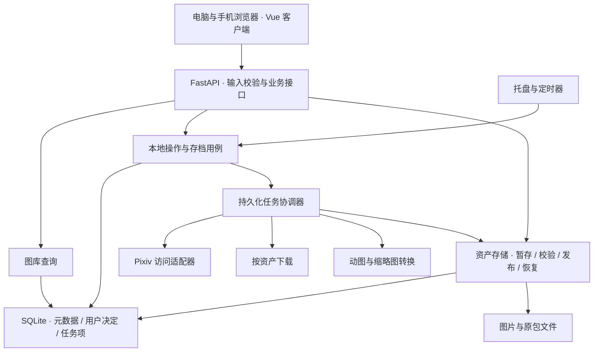

# 实现架构重新评估

日期：2026-09-20。角色：主策划兼技术组长。状态：**评估完成，方案建议；尚未实施或获批开工。**

用户要求：重新独立判断实现方法，必要时允许提出推倒重来的方案，前提是保留现有功能。本文重新比较架构，不把旧审查的“无需重写”作为前提。旧报告保留其当时的证据；本文取代它关于后续实现方向的建议。正式版本范围仍由[功能路线图](../功能路线图.md)管理。

## 结论：重写核心与交互层，保留运行基础

**建议采用 Python + FastAPI + SQLite 的模块化单体，重做存档核心和任务系统；前端采用 Vue 3 + TypeScript + Vite，继续由同一个本地服务提供电脑和手机浏览器访问。通过分阶段替换完成，避免一次切换全部代码和用户数据。**

这里的“重写核心”有明确范围：作品和文件的状态模型、后台任务的保存与恢复、远端访问与本地操作的边界、列表／详情查询、前端交互状态、程序启动和迁移流程。现有安全检查、认证中的原子保存、托盘入口、打包方式及有价值的测试可以保留或适配。

旧报告的“在原结构上修补即可”低估了新愿景的影响。若目标始终只是小型下载器，继续局部修补是合理选择；现在要发展为长期使用的第三方客户端，在线查看、单件存档、停止追踪后保留作品，都需要当前模型缺少的边界。继续在 `Tracker` 和模板脚本中加分支，会让同类问题反复出现。

也没有证据支持现在改成 Rust、Go、Electron、Tauri 或多服务系统。已确认问题主要来自状态归属、重复流程、查询方式和交互时序。换语言会保留这些问题，还增加认证、打包和数据转换的工作。SQLite 已能承担本地主机、多浏览器访问的形态；需要解决的是短事务、正确索引和文件一致性。

本次“最优”指在当前约束下，我推荐采用的方案，判断顺序为：**存档与用户决定可靠 → 现有功能完整 → 客户端交互可持续发展 → 维护与交付成本 → 资源占用**。这不是声称所有候选实现都已经完成性能竞赛。

| 部分 | 推荐选择 | 直接解决的问题 |
| --- | --- | --- |
| 服务与交付 | 保留 Python、FastAPI、Windows 托盘和 PyInstaller | 延续 EXE 启动、电脑浏览器与局域网手机访问 |
| 数据 | 保留 SQLite／SQLAlchemy；重做业务模型，增加明确版本的迁移 | 作品不再依附追踪名单，文件完整性和用户决定可以独立保存 |
| 后台任务 | 应用自己的持久化任务与任务项，初期一个重任务协调器 | 请求不丢失、重启能解释和恢复、同一画师的不同操作不被吞掉 |
| 存档 | 逐页／原包清单、暂存、校验、发布记录、删除阻止状态 | 明确区分发现作品、下载文件、验证完整、生成预览 |
| Pixiv 访问 | 一个受约束的远端适配层，集中认证、限速、错误分类 | 页面和存档流程不用各自处理 Pixiv 协议 |
| 文件传输 | 目标采用 Requests.Session 按清单流式下载；gallery-dl 保留为过渡适配器 | 可以精确补某一页、确定范围和结果；替换前必须通过兼容性门槛 |
| 前端 | Vue 3 + TypeScript + Vite，编译成静态文件随 EXE 分发 | 统一筛选、请求、收藏反馈、列表与阅读位置，减少重复事件绑定 |
| 新基础设施 | 引入数据库迁移工具 Alembic；其余按实际需要增加 | 用版本化迁移替代启动时不断探列和全量回填 |

## 评估基线与实际验证

| 项目 | 本次事实 |
| --- | --- |
| 分支／提交 | `master` / `3705098ff64791c2f6d6f89a149696e8cb0f5506` |
| 源码版本 | `app/src/version.py`：`0.1.1` |
| 工作区 | 原有文档整理和归档改动未提交；本次未改变实现、版本号或 release |
| 现有测试 | 在 `app/` 执行 `py -3.12 -m pytest -q tests`：58 通过，354 条警告，2.81 秒 |
| 原浏览器冒烟 | 本次重新运行 `tests/browser_smoke.py`，桌面与手机尺寸通过 |
| 新补充验证 | 实际路由的离线本地操作、事件循环阻塞对照、实际 JobManager 的异类任务去重、合成查询实验、实际模板的响应乱序实验 |
| 方案比较 | 对同一存档问题分别设计了最小接口、可扩展接口和常见调用接口，再比较状态归属和调用负担 |
| 外部依据 | 核查了 FastAPI、SQLite、Vue、Vite、Requests、Alembic 和 Tauri 官方资料；选型判断由项目约束推导 |

实现入口、测试、构建文件和当前产品文档均纳入重新评估。没有把凭据、真实作品或所有历史归档逐字读取，也没有将旧报告的文件覆盖率冒充本轮覆盖率。此次是**架构选型和关键链路验证**，不是对每一行代码、所有 EXE 和全部真实图库作无缺陷保证。

未运行真实账号下载／收藏，未扫描用户实际图库，未迁移数据，未启动或重新打包 EXE。新架构尚未实现，真实下载兼容性、完整新前端和实际设备性能仍属于后续验收。证据和复现说明见[本轮证据目录](证据/2026-09-20-实现架构重新评估/README.md)。

## 新证据如何改变判断

### 本次直接复现的四项行为

| 事实 | 本次证据 | 架构含义 |
| --- | --- | --- |
| 未登录时本地删除不执行，也不说明原因 | 合成记录经实际删除路由返回 303，记录仍在；取消隐藏的对照操作有效。入口：`routes/works.py:753` | 本地图库能力不应依赖登录后才创建的 Tracker。登记 BUG-047 |
| 同一画师的下载会吞掉后提交的刷新 | 实际 JobManager 两次提交得到相同任务 ID，第二次 `created=false`，只运行下载。入口：`progress.py:60`、`routes/artists.py:185`、`routes/works.py:794` | 去重不能只看画师 ID，必须理解操作目的及覆盖范围。登记 BUG-048 |
| 同步数据库调用阻塞异步页面处理 | 在实际主页的同步 Session 创建点注入 200ms 延迟，事件循环最大心跳间隔 202.87ms；线程池对照为 16.42ms | 当前 `async def` 并没有让同步 ORM 变成非阻塞。登记 BUG-049；200ms 是注入值，不是测得的真实磁盘耗时 |
| 较早的筛选响应覆盖最新操作 | 合成 24 件作品；后请求先完成显示 18 件，释放先请求后变回 6 件，URL 也倒退；浏览器没有 JS 异常 | 需要统一请求与查询状态，而非只补某个按钮。补充 BUG-021 的证据 |

后台结果见 [architecture-probes.json](证据/2026-09-20-实现架构重新评估/architecture-probes.json)，浏览器结果见 [browser-race.json](证据/2026-09-20-实现架构重新评估/browser-race.json)及[现场截图](证据/2026-09-20-实现架构重新评估/stale-filter-response.png)。这些复现脚本“运行成功”表示证明了旧行为，不表示问题已修复。

### 详情导航的实现有可以避免的线性成本

`routes/works.py:385` 为确定前后作品和当前位置，把当前筛选范围内的 ID、投稿时间全部取到 Python，再找当前项。每打开下一件又做一次。排序还需要稳定的 ID 次序来处理同一投稿时间。

我用相同查询形状与一个带索引的相邻项查询做了合成 SQLite 对照：

| 合成作品数 | 当前查询取回行数／中位耗时 | 候选相邻查询取回行数／中位耗时 |
| --- | --- | --- |
| 10,000 | 10,000 行／5.688ms | 1 行／0.034ms |
| 100,000 | 100,000 行／81.003ms | 1 行／0.023ms |

每项为 7 次热运行；候选按 `(posted_at, id)` 查相邻项，结果与稳定排序一致。此实验**不包含 ORM、网络、图片、空日期、总数与当前位置计数**，不能宣传成“整个详情页提速几千倍”。它证明当前取回全部 ID 的成本可以避免，也说明无需先更换数据库。

现有“第几件／共几件”必须保留：另用相同筛选下的计数／排名查询或有版本的导航上下文提供。不能用优化前后项为由删掉计数。页码模式的任意跳页也不能直接换成只有下一页的游标接口。

## 必须保留的功能清单

保留的是用户能完成的操作、数据和合理语义；已确认的失败假成功、缺页假完整等缺陷不作为兼容要求。下表是替换验收清单，不能拿“新页面能打开”代替。

| 现有能力 | 新实现必须保留的结果 | 关键验收 |
| --- | --- | --- |
| Windows EXE 与托盘 | 双击启动、托盘打开画廊／设置、退出 | 实际打包程序验证；使用就绪信号，处理启动失败与端口占用 |
| Pixiv 登录与令牌续用 | 保留登录、授权码提交、已有凭据续用流程 | 隔离凭据存储；需真实账号的步骤另明确测试范围 |
| 手机访问 | 同一局域网手机通过 IPv4／IPv6 访问，无额外配对 | 手机访问同一业务 API；保留当前访问边界和部署形态 |
| 找到并追踪画师 | 搜索／输入 Pixiv ID、去重添加、首次存档 | 重复添加和首次任务失败都能解释 |
| 自动与手动检查 | 定时检查、检查全部、刷新指定画师 | 使用同一用例；单画师刷新是否扩充为检查新作需明确展示语义 |
| 暂停／恢复追踪 | 控制后续自动存档 | 区分追踪策略暂停与正在执行任务的取消，不能暗改现有含义 |
| 移除画师 | 保留“移除记录保留文件”和“连文件一起移除”的选择 | 当前保留文件不等于仍在图库可浏览；新增语义由 Q-004 决定 |
| 主页与画师图库 | 按现有范围浏览作品、数量、限制等级等信息 | 不因未登录而失去本地浏览；不丢作品与显示设置 |
| 筛选 | 画师、插画／漫画／动图、期间、自定义日期、Tag、隐藏项 | 保留空选与未指定全选的区别；当前 Tag 为 OR 语义 |
| 两种翻页 | 无限滚动、页码翻页、每页数量和现有显示上限设置 | 任意页、结果缩小／扩大、空结果恢复、后退与刷新 |
| 作品详情 | 原图、多页、动图、简介、标签、画师、外部 Pixiv 链接 | 简介安全呈现；按原页顺序阅读；已有媒体仍可看 |
| 连续阅读 | 前后作品、位置／总数、键盘左右、触摸滑动、返回列表 | 保留筛选和阅读位置；任务结束不强制刷新整页 |
| 收藏 | 收藏／取消收藏及收藏状态同步 | 显式目标状态；失败可回退、结果不明可查证；不重复反转 |
| 本地整理 | 隐藏、取消隐藏、永久删除及阻止自动重下 | 离线可做；重启、重试和并发下载不会让删除作品复活 |
| 补下载 | 下载待处理作品、单件下载、缺失文件修复 | 单件只处理该件；缺一页准确补缺；已有良好文件不被破坏 |
| 校验与信息补全 | 校验文件、补简介、同步相关元数据 | 各项结果单独报告；合法空简介不反复重试 |
| 本地文件入口 | 打开所在文件夹 | 稳定资产映射可定位旧目录；从手机触发时明确打开的是主机目录 |
| 数据位置与设置 | 选择目录、迁移、分页配置、端口、访问地址 | 迁移失败仍有可用环境；端口的当前值和待重启值分开 |
| 进度与结果 | 看见排队、检查、下载、转换、成功／部分失败／失败 | 每阶段计数有单位，程序重启后任务结果可追溯 |
| 已有数据 | 作品、页、简介、Tag、本地隐藏／评分字段、收藏、追踪状态、删除清单 | 即使字段当前没有 UI，也不能在转换时丢掉 |

在线作品搜索、推荐／排行榜、评分 UI、批量操作、翻译等仍是未来需求，不混入“保留现有功能”的首轮替换范围。

## 当前实现真正需要改变的地方

| 边界问题 | 当前证据与后果 | 推荐处理 |
| --- | --- | --- |
| 画师身份与追踪状态绑在一起 | `TrackedArtist` 同时是身份表和追踪名单；作品通过必填外键与级联关系依附它 | Artist 身份独立于 TrackingPolicy；未追踪画师的一件作品也能长期存在 |
| 文件列表承担过多含义 | `file_paths` 非空被多条路径当作已下载；不能表示预期页数、缺页、损坏和派生物 | 以逐项 AssetManifest 判完整；保留旧路径作为兼容来源 |
| 业务状态分散 | 主库、gallery-dl 去重库、删除 JSON、目录扫描和内存任务各存一部分状态 | 主库持有用户意图和完成事实；外部库与磁盘用于执行和核验 |
| 同一流程在不同入口复制 | 添加、全部检查、单画师刷新、补下载各自编排；路由直接调用 Tracker 私有方法 | 路由与定时器共同调用显式业务用例；固定阶段在内部复用 |
| 远端和本地过度耦合 | `web.py:48` 登录后才创建 Tracker；本地删除因此依赖登录 | LocalLibrary 总能启动；只有远端步骤进入等待登录状态 |
| 长任务状态不可恢复 | `JobManager` 保存内存闭包和近期限量历史 | 接受请求先持久化参数和任务项，重启后对账；不能把闭包序列化当恢复 |
| 路由、数据和启动互相依赖 | models 迁移函数反向导入 routes；配置导入包含建目录和旧数据迁移；运行对象分散为全局变量 | 统一启动入口建立 Runtime，模块显式接收依赖，读配置无迁移副作用 |
| 数据库与文件动作没有共同恢复边界 | 改名、删除、转换和迁移跨多次文件与 DB 操作；失败可能停在中间状态 | 操作记录、暂存／隔离区、幂等恢复；不假装文件系统与 SQLite 有一个共同事务 |
| 前端多个脚本争夺页面状态 | 模板脚本重复处理筛选、追加列表和收藏；任务结束整页 reload | 组件与查询状态统一；响应必须属于当前请求才可应用 |
| 启动与查询反复做全量工作 | 启动回填所有 tags，重扫文件；详情取全部匹配 ID | 显式迁移只跑一次，按需／后台对账，索引与有界查询 |
| 构建缺少完整可重复入口 | lock 文件只有直接依赖；批处理有清理、覆盖及外部工具调用 | 隔离构建环境、完整依赖锁定、唯一版本来源、新目录产包与证据清单 |

已有的请求来源校验、Host／同源写入限制、路径越界防护、HTML 处理、令牌原子保存、删除清单和运行任务不因 TTL 被清掉，均有保留价值。重写不能借机撤掉这些边界。现有测试继续作为外部行为回归的起点，不为追求新结构删除旧测试。

## 实现路线的取舍

| 路线 | 收益 | 主要代价与问题 | 判断 |
| --- | --- | --- | --- |
| 继续原地修补 | 最快缓解少量已知缺陷，数据转换少 | 每增加在线、本地、暂停、重试组合，都继续穿过旧耦合；前端状态重复维护 | 只适合确有急需的独立修复，不适合作为长期路线 |
| 仅拆文件、保留原模型与模板流程 | 改动看似小，代码位置整齐 | 不改变谁拥有状态，缺页／去重／迁移等矛盾仍在；容易成为换目录名的重构 | 不选 |
| 重做后端核心，Jinja 配合模块化 TypeScript | 同样能够修好当前交互缺陷；页面组织变化较少 | 未来跨本地／在线的卡片、阅读与缓存状态，仍需自己设计组件生命周期和局部结果同步 | 可行的较小方案；若愿景回到下载管理器，它会更有吸引力 |
| 重做业务核心与浏览器客户端，保留后端技术栈 | 直接解决已证明的边界问题，保留成熟运行链路；未来在线和本地共享作品模型 | 需要真正设计状态、迁移和功能对照；初期同时维护兼容层 | **推荐** |
| 换语言或桌面壳并整体重写 | 可获得特定原生集成或新的开发习惯 | 尚无证据证明能解决本次瓶颈；需重建认证、打包和本地服务；手机仍需 HTTP 服务 | 当前不选；将来有具体原生需求再评估 |

框架本身不会自动修复状态错误，这些 BUG 也不能单独证明 Jinja 不可用。选择 Vue 的决定性理由是已确认的长期客户端愿景：让本地与未来在线视图共用明确的组件和状态管理方式；并非 React 或 Svelte 不能完成。模块化 TypeScript 也是认真可行的候选，但需要自行持续维护更多交互组织机制。Vue 的额外成本是构建工具、类型检查和组件迁移，本方案认为该成本值得承担；尚未用两套完整原型证明维护工时差距。引入 htmx 可以改善局部更新，却不能免除阅读位置、复杂筛选和远端收藏的客户端状态设计，因而不作为长期主方案。

Vue 官方区分了静态增强与具有丰富交互的单页应用用法；Vite 可以构建静态分发文件。这里选择后者，**Node 只用于开发和构建，用户运行 EXE 不需要安装 Node**。这是一项部署设计，需由新 EXE 验证，而非本轮已经完成的结果。[Vue 使用方式](https://vuejs.org/guide/extras/ways-of-using-vue)、[Vite 构建文档](https://vite.dev/guide/build)。

## 核心接口也重新比较，而非沿用 Tracker

### 方案 A：最少入口

概念形式为 `request(typed_command)`、`inspect(typed_query)`、`read_asset(asset_id)`。命令和查询必须是封闭的有类型集合，不能放任意字典或回调。

优点是外部入口少，隐藏事务和调度。问题是如果追踪、查询、删除、迁移、收藏全塞进一个对象，复杂性只是藏进一个巨大的命令表。可以作为边界风格，不能据此制造另一个万能 Tracker。

### 方案 B：以“用户想保留什么”为中心

将 ArchiveIntent（保留／禁止重下的决定）和 Operation（某次执行）分开。任务失败或程序重启后，仍可根据用户意图与实际文件差异继续处理。

优点是天然支持缺页修复、单件存档、停止追踪和恢复。问题是若推广成通用工作流引擎、事件溯源或任意任务图，复杂度超过当前需要。采用其内部数据思想，限制为本项目的固定阶段。

### 方案 C：以页面和定时器的常见操作为入口

提供 `track_artist`、`refresh_artist`、`refresh_tracked`、`download_work`、`repair_library` 等命名明确的用例；本地的 `set_hidden`、`delete_work`、`remove_artist` 和远端的 `set_bookmarked` 分属各自职责。

优点是执行者一眼能看到某个用户动作做什么；不同调用者复用同一流程，不暴露文件改名、archive 清理和计数细节。代价是方法数量较多，需要共用内部步骤，避免逐个复制流程。

**采用 C 的公开接口、B 的内部状态、A 的封装原则。** 这些接口是建议契约，不是已新增代码。不要让路由传 `lambda`、指定下载目录或自己生成去重键；业务层接收稳定 ID、明确意图和请求标识，再返回可查询的操作结果。

## 推荐结构及依赖方向

仍是一个产品、一个本地服务和一份主业务数据库。首轮一个重任务协调器即可；文件转换可用受控工作进程，隔离大图内存消耗与取消。收藏等短交互有独立的有界执行通道，共享远端限速与认证，避免排在数小时首次下载之后。业务上只有一个任务归属者；短数据库写事务串行协调，不把网络等待放在写锁里。

初期不引入 Redis、Celery、微服务、跨机器任务租约、通用插件总线、全事件溯源或面向所有网站的下载框架。它们解决的问题尚未出现。也不要求把所有同步 Python 改成 async：普通数据库接口使用同步路由或明确线程池边界，网络下载放后台；只在真正使用非阻塞库时采用异步调用。FastAPI 官方明确说明同步路径函数会在线程池中运行，而直接调用的普通辅助函数不会自动获得该待遇。[FastAPI 并发说明](https://fastapi.tiangolo.com/async/)。

执行时再在 `app/` 内建立用途明确的模块，遵循“先写目录规则再建目录”：`domain` 保存稳定业务概念，`application` 保存用例，`infrastructure` 负责 SQLite／文件／Pixiv，`web` 负责接口，`frontend` 负责浏览器客户端，`bootstrap` 负责组装。按真实边界拆，不强制每张表配一层空壳 Repository，也不让领域对象依赖 FastAPI、ORM 会话或模板。

## 数据与存档：先把事实分开

### 建议的最小业务模型

| 对象 | 负责什么 | 必须避免 |
| --- | --- | --- |
| Artist／Work | Pixiv 身份、作品信息、页数、类型、元数据来源和更新时间 | 把“画师存在”解释为“正在追踪” |
| TrackingPolicy | 是否追踪、是否暂停、检查策略与进度 | 删除追踪策略时级联删除所有作品 |
| LocalPreference | 隐藏、评分等本地决定 | 远端元数据刷新覆盖本地选择 |
| ArchiveIntent／Suppression | 用户希望保留、明确删除并阻止自动恢复的范围与版本 | 下载开始时判断一次，发布前不再检查删除决定 |
| AssetManifest | 每页／原包的身份、用途、相对路径、大小、校验状态和缺失原因 | 文件列表非空就视作作品完整 |
| Derivative | GIF、缩略图等派生文件与其输入版本／生成器版本 | 把可重建预览与不可替代原件混为一类 |
| Operation／OperationItem | 持久化请求、执行阶段、逐项结果、重试与中断原因 | 只记录一个瞬时总进度和内存函数 |
| RemoteAction | 收藏等操作的目标状态、已确认状态和结果不明状态 | 超时后盲目 toggle，或把本地值当成远端成功证明 |

这是概念边界，不强制每一行对应一张独立表。首个实现包应给出唯一键、约束、索引和迁移草案后再确定物理结构。Tag 保留可查询关系；原始远端 JSON 可作诊断快照，但不能成为每次页面查询都解析的唯一结构。

分别记录“首次发现”“获取元数据”“文件验证完成”等时间；当前 `downloaded_at` 在创建记录时默认赋值，不能直接解释成成功下载时间。新时间统一明确的 UTC 存储和用户时区显示；历史值来源不明的保留原值与不确定标记，不能全部机械减 9 小时。

### 完整存档的成立条件

一件普通多页作品，只有预期页的身份齐全、文件可读且验证通过，才是完整存档；下载进程退出 0 或某目录多出一个文件都不够。页数未知时应显示“未核实”，不要制造“完整”的假象。远端更新导致页数／文件版本变化时重新对账，已有本地内容先保留。

Ugoira 至少分清输入 ZIP、帧时序和显示用 GIF。时序缺失、帧数对不上、转换失败时保留输入并报告失败。成功后是否长期保留 ZIP 仍是 Q-003；本报告建议保留，但不冒充用户已决定，也不为验证通过自动执行删除。

每页保存本地散列可发现之后的文件变化；若远端没有可信散列，本地 SHA-256 **不能证明与远端原件完全相同**。还要核对页身份、响应内容、长度、解码／ZIP 结构等。检查采用分级策略：平时检查清单和文件基本信息，深度校验按需运行，避免每次启动扫描全部大文件。

### 文件发布与删除的恢复规则

下载先进入目标卷的暂存区，校验后写入待发布记录，再以原子重命名发布并提交清单。每个中间状态都能在重启时判定继续、回退或保留待处理文件。不能声称“SQLite 事务包住文件操作”就获得跨文件与数据库的原子性；Windows 文件占用、权限失败和跨卷移动都必须测试。

删除先可靠保存用户的阻止重下决定和操作记录，再把文件移入隔离位置，最后更新可见状态并完成清理。发布下载结果前再次检查意图版本，防止用户删除后，旧任务把内容写回来。程序崩溃后继续按记录对账，不根据“目录里还有文件”擅自复活作品。

媒体通过 `/media/{asset_id}` 等稳定标识提供，数据库保存受控的相对位置。新文件可采用稳定 ID 命名；画师改名只改显示信息。已有目录先建立映射，不为目录美观强制搬动全库。仍提供打开实际文件夹的入口，不能牺牲用户找原图的能力。

## 任务与下载的具体选择

### 持久化的是用户意图与结果，不是线程

接受一个后台请求时，先用短事务保存操作及其范围，再回传任务 ID。状态至少能表达排队、运行、等待登录／网络、部分失败、失败、取消、中断和成功；阶段与计数一次更新，计数来自 OperationItem，明确作品、页面、字节等单位。

重启后把上个进程未结束的运行记录识别为中断，核验已发布文件后再恢复。远端写操作结果不明时先查询确认；不能承诺端到端“恰好执行一次”。本地步骤通过稳定键与重复执行安全保证恢复，执行过程始终允许记录失败。

去重使用“操作类型＋范围＋相关意图版本”。同一画师的下载与刷新可以排队、明确合并覆盖范围，或显示忙碌让用户重试；不能悄悄返回旧任务当成接受了新要求。手动收藏使用 `set_bookmarked(true/false)`，同一作品按顺序处理，旧查询不能覆盖较新的用户意图。

暂停追踪负责停止后续自动同步，任务取消负责停止当前处理，二者分开。建议提供安全停止任务的能力，但用户端按钮和精确生效时机需在执行包中确认；本轮不把旧暂停按钮自动改义。

### 为什么目标选择直接按资产下载

当前 `client.py` 已解析逐页原图 URL，`tracker.py` 却再次把整位画师交给 gallery-dl 枚举。长期客户端本来就需要自己掌握远端作品信息，再让第二套作品提取与去重逻辑决定下载范围，会形成重复判断。

**目标选择：PixivSource 返回资产描述，Requests.Session 在受控工作线程中按单个资产流式下载；应用负责暂存、校验、发布和结果。** 每个工作线程拥有自己的 Session，设置连接／读取超时，及时关闭响应，集中处理重试预算、代理、限速和凭据刷新。按块处理取消；线程不能在任意时刻强杀，最坏等待受读取超时限制。首版可从单传输通道开始，不以提高并发掩盖协议与状态问题。[Requests 的 Session 与流式响应文档](https://requests.readthedocs.io/en/latest/user/advanced/)。

这不是认定 gallery-dl 只能下载画师。本机安装的 1.32.1 明确包含 `PixivWorkExtractor`，能够处理单件作品；BUG-044 的整画师范围来自本项目调用方式。保留 gallery-dl 并缩小调用范围也能修复该缺陷。选择新的传输边界，是为了长期避免两个系统共同管理作品、进度和完整性，并非因这一个 BUG 就删掉依赖。

**替换门槛：** 在隔离用例以及用户指定的少量真实作品中，对照单图、多页、Ugoira ZIP 与时序、代理、重定向、401／403／429、URL 过期、断流、超时、磁盘不足和取消。校验请求头、可用 URL、错误分类、文件字节与恢复结果。只把 token 交给需要它的认证请求，不能随 CDN 重定向传播。断点续传仅在 Range 和远端版本验证可靠时启用；否则明确重新下载暂存文件，不能拼成损坏文件。

通过门槛前，现有 gallery-dl 作为兼容适配器继续可用，收窄到明确的作品范围，并让结果服从应用自己的清单验证。它的去重 archive 只作为历史提示，不能证明本地文件仍完整。若直接下载在必需的 Pixiv 场景中缺失能力或维护负担明显高于适配成本，则保留该适配器；不以“已经写了新下载器”为理由牺牲兼容。此门槛只影响传输实现，不改变应用拥有清单与用户意图的核心选择。

生产环境每个任务采用一种明确的传输策略，不在失败后偷偷切换另一下载器扩大范围。完成兼容性验证后选择并收敛主路径，避免永久维护两套独立生产流程。

## 前端如何重做而不丢体验

Vue Router 管理页面与可分享的筛选 URL。可序列化的 GalleryQuery 是列表、详情导航和返回的共同输入；后端只有一份过滤与排序定义。没有参数表示全选，显式空集合表示空选，继续保留当前语义。

将状态分为三类：URL 中的筛选／排序／页码；按查询键保存的服务端结果；当前面板、选择项、滚动锚点等临时 UI 状态。需要跨页面共享的状态放小型 store，组件私有状态留在组件；不把每张图片和全部历史响应塞进永久全局对象。

每个结果请求带查询键和请求序号，旧响应不得改当前列表；AbortController 用于减少无用请求，序号校验负责最后的正确性。追加列表必须归属原查询，重置筛选同时重置游标／页码／已加载集合。收藏动作只有一套处理入口，展示处理中、成功、失败和结果待确认，不能通过多个 DOM 扫描反复绑定。

返回列表以“作品 ID＋项内偏移＋查询键”恢复，不能只记整个页面的像素值。任务进度先沿用轻量轮询，任务完成仅更新有关数据，不全页 reload；有明确需求再增加 SSE。无限滚动提供有界渲染和稳定占位，分页保留任意跳页；不是简单截掉 DOM 就算解决内存问题。

列表提供受控尺寸缩略图，详情按阅读方向预取有限页数，未到视口的原图按需加载。缩略图是可重建派生物，生成失败可回退，不应阻塞原图查看。是否引入现成虚拟列表组件，在固定测试图库和手机连续滚动测量后决定，避免先叠一套复杂布局系统。

TypeScript 负责接口与状态类型；接口响应仍由服务端校验，不因有 TS 就信任网络数据。Vite 构建之外另跑 `vue-tsc`：官方说明 Vite 的 TypeScript 转译不等于类型检查。[Vue TypeScript 指南](https://vuejs.org/guide/typescript/overview)。首轮重做承载方式，保留现有视觉与操作入口；首页信息架构大改、图标更新和新在线板块另走产品讨论。

## 数据库、启动和目录迁移

保留 SQLite WAL 和外键约束，网络等待不占写事务，所有页面 Session 按请求／工作项关闭。WAL 支持读写并行，但同一时刻仍只有一个写者；不把增加线程数理解成无限数据库写吞吐。数据库保持在主机本地受支持的存储上，手机通过服务访问，而不是共享数据库文件。[SQLite WAL 官方说明](https://www.sqlite.org/wal.html)。

新库使用明确的 schema 版本和 Alembic 迁移，不在每次启动全量回填 tags。SQLite 的部分表修改需要重建／复制表，迁移时间和磁盘空间应进入验收；自动生成 DDL 不会代替旧路径、删除清单和历史时间的业务转换设计。[Alembic 的 SQLite 批处理迁移](https://alembic.sqlalchemy.org/en/latest/batch.html)。

建立显式 Runtime，集中拥有设置、数据库连接工厂、LocalLibrary、PixivSource、协调器和调度器。创建配置对象不建库、不复制目录、不修改 `.env`。登录是远端能力的状态，不影响本地图书库初始化。Web 和托盘共用真正生效的监听地址，端口设置另保存“下次启动值”。就绪、停止和后台线程退出都有明确事件与超时。

保留应用内目录迁移能力，但要把准备目标、复制一致快照、校验、候选 Runtime 检查、切换配置、激活与恢复纳入同一操作记录。候选失败前旧环境仍可工作；切换后失败则按记录恢复到可用状态或明确维护模式。旧环境不可在新环境未准备好时先被清空。迁移忙碌时的写入拒绝、只读浏览和用户反馈须统一，不能各路由自行判断。

## 分阶段替换与退出条件

以下是本方案的工程顺序，**不是第二份版本路线图，也不是开工授权**。若采用，由[功能路线图](../功能路线图.md)给每个批准包分配版本和精确范围。本轮不直接启动旧 v0.1.2 草案。

| 阶段 | 实际工作 | 进入下一阶段的门槛 |
| --- | --- | --- |
| P0 功能与兼容契约 | 把上方功能矩阵落实为外部行为场景；确认暂停、移除和 Ugoira 政策；固定合成图库与旧版对照 | 各现有入口有去向，数据字段映射完整；新增建议与原功能区别清楚 |
| P1 最小新核心闭环 | 在隔离库中实现发现一件作品、逐项下载、验证、读取、隐藏／删除、中断恢复；验证传输替换门槛 | 多页缺损、失败保源、删除阻止恢复、离线本地操作和故障恢复通过；不碰真实库 |
| P2 接入现有业务入口 | 定时器和旧页面经兼容路由调用新用例；补齐追踪、刷新、补全、收藏、移除、迁移等能力 | 所有重任务进入同一协调器；旧流程不再独立写同一候选库；功能矩阵后端项通过 |
| P3 新浏览器客户端 | Vue 页面覆盖图库、画师、详情、设置和登录反馈；补齐稳定查询、预览和返回位置 | 桌面／手机、鼠标／触摸／键盘、两种翻页、连续操作与乱序响应通过 |
| P4 数据转换演练 | 在授权副本上导入旧库、删除清单、路径和派生关系；核验数量、散列与语义差异 | 生成可读迁移报告，无静默丢弃；中途退出、失败与回滚流程实测 |
| P5 候选 EXE 与切换 | 从固定提交和锁定依赖构建新目录交付物；小范围真实账号验收；最后切换实际数据 | 原有功能矩阵、异常恢复、EXE 和实际手机验收通过；用户确认后才替换日常版本 |

不要把核心、数据库、下载器、前端、桌面壳在一次不可回退的切换中一起更换。P1 先证明最难的存档闭环；P2 利用现有 UI 保持可检查；P3 再换交互层。候选文件夹和旧 release 分开，旧程序仍可使用旧数据，但不能与新程序同时写一份图库。

### 数据转换与回滚必须写进执行包

1. 先记录旧库版本和所有有意义的字段，包含隐藏、未使用的评分、简介状态、删除阻止记录、收藏、画师启停和文件映射。重复、损坏或无法识别的记录进入报告，不能静默丢弃。
2. 冻结旧写入后，用 SQLite 一致备份方法取得副本，不只复制可能仍依赖 WAL 的主文件。旧数据保留，新库单独生成；真实转换及配置切换须在批准范围内执行。
3. 旧文件优先通过映射引用，演练阶段只读；若候选需要删除／改写，使用独立媒体副本，不能以硬链接共享可变原件冒充隔离。目录不会因画师改名被整批重新搬动。
4. 导入 gallery-dl 去重信息只作提示；按实际文件重建核验状态。旧永久删除清单必须先导入并验证，损坏时阻止自动重下并报告，不能当作空清单继续运行。
5. 正式切换前保留可恢复的旧状态，并验证旧 EXE 的访问方式。新版本尚未产生新写入时可以回到旧快照；产生新的收藏、本地决定和文件后，回滚还需要对账／兼容导出，不能只换回旧 EXE 并宣称无损。
6. 不自动删除旧库、旧 release、迁移备份或历史目录。清理须另有范围与许可，不能成为测试脚本的附带动作。

### 验收不是只跑现有 58 项测试

| 层次 | 必须证明的行为 |
| --- | --- |
| 领域与状态 | 重复请求、不同意图、取消／恢复、远端与本地状态分离、稳定排序、空选筛选、未知值 |
| 故障恢复 | 写入前／后、重命名前／后、转换中、任务提交后崩溃、锁定文件、磁盘不足、迁移各切换点 |
| 真实模块集成 | 临时 SQLite＋临时文件＋可控 HTTP 对端；不用一串 mock 代替真实事务与文件发布 |
| 浏览器 | 快速连续筛选、逆序响应、空结果恢复、追加后收藏一次、详情返回、后台完成时阅读不跳走 |
| 性能 | 固定 1 万／10 万合成元数据与可控媒体集；记录首屏、查询、内存、连续翻页和并行后台任务的尾延迟 |
| 迁移 | 旧字段逐项映射、文件和删除记录对账；失败可恢复；数据量与设备信息一起记录 |
| 本地交付 | 打包后的实际 EXE、离线启动、本地无登录操作、托盘、端口变化、局域网手机、配置重启保留 |
| Pixiv 兼容 | 用户约定的少量真实作品与账号读写范围；不得用静态检查替代下载、收藏的实际结果 |

性能门槛先在 P0／P1 记录同机旧版基线并结合用户设备确定，不能把上述单条 SQL 的 0.023ms 写成产品目标。确定后再放入批准的执行包。新系统应证明慢下载／转换时界面仍响应，图库扩大不会让每次导航搬回全部 ID；还应量化缩略图与有界渲染的资源收益。

构建锁定直接和传递依赖、解释器及前端包管理器版本，在隔离构建环境执行。输出源码提交、测试摘要、构建环境与 SHA-256；本地包、用户验收、Git 合入、标签、公开发布分别记录。此次不会运行现有含删除／覆盖行为的 `release.bat`。

## 仍需产品决定的少数问题

本轮已能选定架构，不需要用户先回答几十个技术选项。进入实施前，沿用并收敛以下问题：

| 问题 | 当前推荐 | 不确认时的处理 |
| --- | --- | --- |
| Q-003：Ugoira 成功后保留原包吗 | 长期保留原 ZIP 和时序，GIF／缩略图可重建 | 失败必须保源；成功后的长期政策不自动改变 |
| Q-004：停止追踪后是否仍能浏览已有作品 | 停止自动更新与删除内容分开，保留本地浏览 | 兼容现有两个移除选项，不把新语义写成已实现 |
| 暂停对已排队／进行中任务何时生效 | 自动同步暂停与当前任务取消分别表达 | 保留现有追踪开关语义，新增交互另写入执行包 |

Vue、SQLite、任务表、文件清单等是技术组长可以给出的选型建议，无须逐项让用户在库名之间选择。真正需要确认的是采用该方向后的实施范围、上述操作后果，以及数据转换与交付验收。

本报告建议改变旧“继续原地修补”的路线，采用**核心与前端有边界的重写**。保留功能以清单验收，保护数据以恢复机制验收，技术选型以实际契约和交付验证约束；不会因为允许重来就把已有有效实现全部扔掉。
