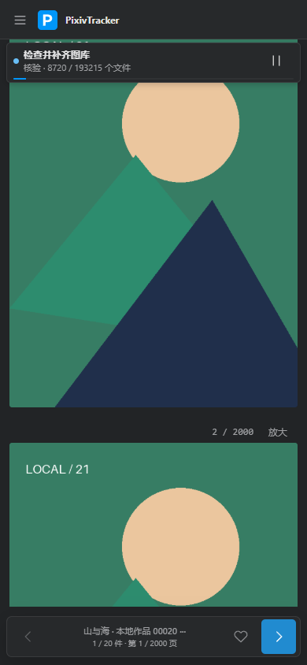
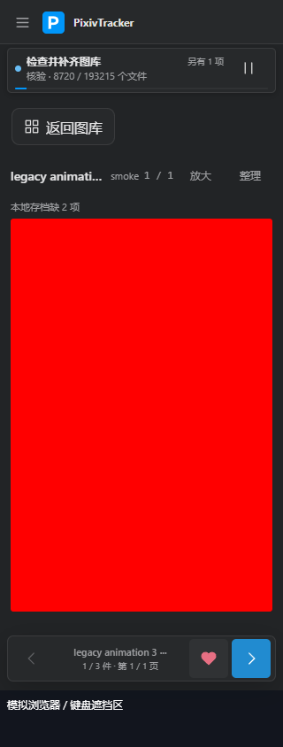

# 手机遮挡与画师批量核对

- 范围：BUG-101／102、R-064／065；用户手机截图、Chrome 最新版说明与追加的画师批量核对请求。
- 基线：`main / 8e4fef3`，0.2.0 · 20261003.6；实现位于 `codex/v0.2.0-build20261003.7`，公开版本不变。
- 状态：代码、后端回归、源码浏览器与最终 EXE 已验证；正在接回日常实例，实体手机与用户体验未验收。
- 实现提交：`6ff05c85c35dcc32f8fb0305a1d22b719ebd4d1d`；打包时源码干净，之后只修测试夹具并补交付记录。
- 不变边界：无新依赖、数据库结构转换、真实账号专项或额外批量测试；旧 EXE、图库、配置与令牌保留。

## 修订与依据

| 问题 | 原因与修改 |
| --- | --- |
| 手机进度遮图 | 原布局单任务高 75 CSS px、并行任务约 95 px；两行紧凑信息和独立 44×44 暂停／继续按钮将普通状态压到 51 px，保留真实分子／分母与并行数量。 |
| 深色暂停按钮刺眼 | 使用了不存在的主题变量并落回浅色默认值；改用现行主题变量，手机改为图标按钮。 |
| 底栏被浏览器区域遮住 | 单靠 `100dvh` 与安全边距不能处理布局视口和可见区域不一致；应用、阅览和缩放层共用可见底边，重叠安全区域不重复扣除。 |
| 画师批量状态不明确 | 旧维护隐含于资料刷新且排在作品之后；复用同一次主页响应记录来源事实和刷新资料，新维护先核对范围内画师，明确显示“核对画师”。 |

- 进度仍为浮层，清点无可靠分母不编百分比，断线保留错误提示、禁用控制并撤下旧进度轨道，空闲消失。
- 可见区域变化通过浏览器事件合并至绘制帧；地址栏、键盘、横竖屏恢复会更新，原生捏合放大时不重排阅览布局。
- 画师范围包含停追踪、零作品画师；指定画师或作品只核对对应画师并去重，不另建批量按钮。
- 可信无法访问沿用设置一览及头像标记；401、403、429、5xx 与网络失败不覆写已有来源事实，本地图片和资料保留。
- 主页可访问而头像失败分别记载；旧维护游标及 `profile-* / metadata_artist` 标识保留，重启不重做已完成项，也不把旧任务重排。

Chrome 的[可见视口行为](https://developer.chrome.com/blog/viewport-resize-behavior)和[底部边缘区域说明](https://developer.chrome.com/docs/css-ui/edge-to-edge)用于建立复现条件；本次未连接用户实体手机，不能据模拟结果断言其黑条的唯一系统原因。

## 分层验证

| 层次 | 本次证据与边界 |
| --- | --- |
| 前端 | 83 项单元检查及生产构建通过，覆盖可见底边、捏合与画师阶段文本；最终资源为 `index-DR1s9CmB.js`、`index-lWY2X8QY.css`。 |
| 后端 | 全套 527 项：526 通过、1 处旧夹具前提失败；补齐该用例的合成已连接身份后，原迁移 5 项均通过，未改产品或放宽断言。画师维护 87 项专项也通过，与全套重复项不累加。 |
| 旧前端浏览器 | 448 项通过、160 项失败；390／360／320px 复现进度过高及可见区域收缩后底栏超出；基线 JS／CSS 散列与实际运行的 .6 相同，旧安全边距单独场景已通过。 |
| 旧 EXE | 自带冒烟通过、留有局部截图，整轮 UI 探测未完成；不将其当作完整旧包 UI 验证，也不当作包失败。 |
| 最终源码浏览器 | 737 项通过、0 页面错误；20 件合成作品、2000 页长作，320／360／390px、1440px、明暗主题、触摸、暂停／继续、未知分母、断线、空闲、横竖屏、安全区与可见区域恢复。 |
| 最终 EXE | 737 项通过、0 页面错误，26 项包内冒烟通过；三件包内合成作品、浏览器响应回放，实际供给的 HTML／JS／CSS 与源码最终资源散列一致，正常退出码 0。 |
| 实体手机 | 未验收；需用户在原 Chrome 中刷新，复查地址栏显示／收起、连续滚动及底栏点击。 |

### 关键几何

| 条件 | 修改前 | 修改后 |
| --- | --- | --- |
| 手机普通任务浮层高度 | 75 px | 51 px |
| 手机并行任务浮层高度 | 94.84 px | 51 px |
| 手机暂停点击目标 | 44×42 px | 44×44 px |
| 布局高 844、可见底边 780 | 底栏底边 834，超出 54 px | 底栏底边 770，留 10 px |
| 键盘回放，可见底边 450 | 底栏底边 834 | 底栏底边 440 |

原生 Chromium 安全区使用 0／24／48 px；可见视口场景明确采用 getter 与 resize／scroll 事件回放，不能冒充真实 Android 地址栏。旧、新测试使用同一合成内容，所有测试目录保留且不自动清理。

- 后端旧失败为迁移测试在离线 Runtime 中等待模拟下载起跑；离线门禁正确保留任务，补齐模拟连接后原有 409、原目录／配置不变等断言全部保留并通过，没有重复跑无关用例。
- 包内冒烟首轮准备约 164 秒，超过测试原 120 秒探测预算；调整验证等待至 300 秒并记录阶段，最终准备 78.265 秒、连同 UI 检查共 112.234 秒，这不是日常启动时间。
- 第二轮 UI 夹具的收藏身份版本落后于包内离线状态；统一合成身份和接口回放后完整通过，收藏只验证控件命中，不构成主站账号写入验收。
- 历史 `reading_browser.py` 的离线下载夹具也需在下次使用前修正，已记入测试目录说明；本轮没有运行或沿用其旧结果。

[验证摘要](证据/2026-10-03-手机遮挡与画师批量核对/validation-summary.json)、[完整后端首轮](证据/2026-10-03-手机遮挡与画师批量核对/backend-full.xml)、[迁移夹具复验](证据/2026-10-03-手机遮挡与画师批量核对/relocation-fixture-after.xml)、[源码浏览器](证据/2026-10-03-手机遮挡与画师批量核对/source-after.json)、[EXE 浏览器](证据/2026-10-03-手机遮挡与画师批量核对/exe-browser.json)、[包内冒烟](证据/2026-10-03-手机遮挡与画师批量核对/exe-smoke.json)。

## 交付

- 候选包：`release/v0.2.0/build-20261003.7/`，75,167,294 字节；Python 3.12.13、PyInstaller 6.20.0、Windows 11。
- SHA-256：`a3becf4e3b539d1762215ef0182ecf13b95f868430ab7c12a856e2d227909b70`。
- 正常启用：最终验证后接回 `D:\PixivTracker`，不使用 `--offline`；已有登录、自动检查与旧待办须分别核对。
- 正式证据已收录于本报告对应目录，仅合成结果与脱敏汇总；未复制真实图库、令牌或账号资料，未公开发布。
